# Guía detallada e ilustrada: entender de verdad el notebook de la opción B

> **Qué es esta guía.** Es la versión larga de [guia_desde_cero.md](guia_desde_cero.md): los mismos capítulos, pero
> cada idea va con **un dibujo hecho con nuestra propia red entrenada** (`detector_multiclass.pt`) y con las
> **mismas imágenes que usa el notebook**. Nada de lo que ves es inventado: es lo que pasa de verdad dentro de la red.
>
> **Cómo leerla.** En VS Code abre la vista previa con **Ctrl + Shift + V** (se ven las imágenes y las fórmulas).
> Lee en orden. Al final de cada capítulo hay un recuadro **✅ Compruébalo** con 2–3 preguntas: si sabes
> contestarlas, pasa al siguiente; si no, vuelve a mirar el dibujo.
>
> **Las imágenes** están en la carpeta [guia_img/](guia_img/). Se regeneran con
> `python notebooks/guia_img/hacer_figuras.py` (desde la carpeta `sujet_tensorboard`).
B
---

## Índice

0. [El problema, en un dibujo](#0-el-problema-en-un-dibujo)
1. [¿Qué es una imagen para un ordenador?](#1-qué-es-una-imagen-para-un-ordenador)
2. [Tensores y formas (`shape`)](#2-tensores-y-formas-shape)
3. [La neurona](#3-la-neurona)
4. [ReLU, sigmoide y softmax](#4-relu-sigmoide-y-softmax)
5. [La convolución](#5-la-convolución)
6. [BatchNorm](#6-batchnorm)
7. [La red completa y el viaje de una imagen](#7-la-red-completa-y-el-viaje-de-una-imagen)
8. [La cuadrícula: cómo se dice «dónde» con números](#8-la-cuadrícula-cómo-se-dice-dónde-con-números)
9. [La pérdida: medir el error](#9-la-pérdida-medir-el-error)
10. [Entrenamiento y validación](#10-entrenamiento-y-validación)
11. [Cómo aprende: el descenso de gradiente](#11-cómo-aprende-el-descenso-de-gradiente)
12. [Medir si funciona: IoU y matriz de confusión](#12-medir-si-funciona-iou-y-matriz-de-confusión)
13. [Lo que «piensa» la red: el projector](#13-lo-que-piensa-la-red-el-projector)
14. [TensorBoard](#14-tensorboard)
15. [Resumen de todo el recorrido](#15-resumen-de-todo-el-recorrido)

---

## 0. El problema, en un dibujo

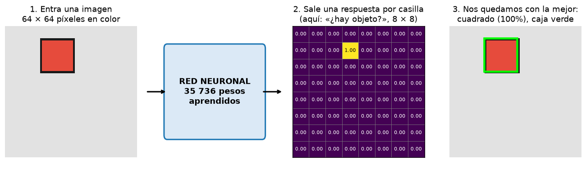

Así funciona todo el proyecto, de izquierda a derecha:

1. **Entra** una imagen de 64 × 64 píxeles con **una** figura (círculo, cuadrado o triángulo), de un color al azar.
2. La **red neuronal** la transforma en una **cuadrícula de 8 × 8 casillas**. Cada casilla responde a varias
   preguntas. En el dibujo solo ves una: *«¿está el centro de la figura en mi casilla?»*. 63 casillas dicen
   0.00 (no) y una dice 1.00 (sí).
3. Cogemos la casilla que dice «sí», leemos **qué caja** propone y **qué forma** cree que es, y la dibujamos
   (caja verde). Aquí: *cuadrado, 100 % de confianza*.

La gracia: **nadie le ha explicado a la red qué es un cuadrado**. Le hemos enseñado 3 000 ejemplos con la
respuesta correcta y ella ha ajustado sola sus 35 736 números internos (los **pesos**) hasta acertar.

Todo lo que sigue explica qué pasa **dentro** de esa caja azul «RED NEURONAL».

---

## 1. ¿Qué es una imagen para un ordenador?

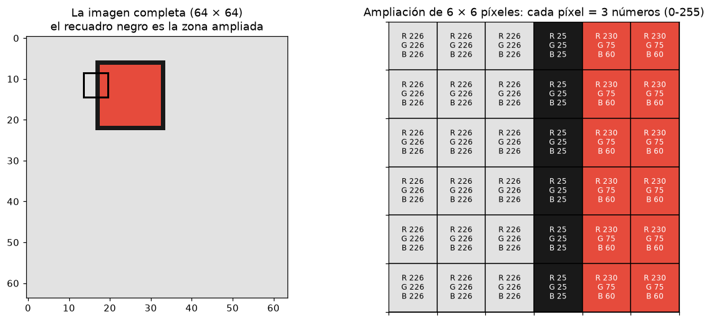

A la izquierda, la imagen del notebook (la etiqueta del generador es `25.0 14.0 16 16 1`: un cuadrado).
A la derecha, un trocito de **6 × 6 píxeles ampliado**, justo en el borde izquierdo del cuadrado. Fíjate:

* Las 3 primeras columnas son **fondo**: `R 226, G 226, B 226` → un gris claro (los 3 iguales = gris).
* La 4.ª columna es el **contorno**: `R 25, G 25, B 25` → casi negro.
* Las 2 últimas son el **relleno**: `R 230, G 75, B 60` → mucho rojo, poco verde y azul = rojo.

**Eso es todo lo que el ordenador «ve»**: 64 × 64 = 4 096 píxeles, cada uno con 3 números →
**12 288 números**. No hay «cuadrados» ni «rojo»: solo números del 0 al 255.

**En el código** (`to_tensor` del notebook): los números se dividen por 255 → `230` pasa a ser `0.90`.
Así todos quedan entre 0 y 1, que es el rango con el que las redes aprenden mejor.

> ✅ **Compruébalo**
> * ¿Qué 3 números tendría un píxel blanco? ¿Y uno negro? *(255, 255, 255 y 0, 0, 0)*
> * ¿Por qué el fondo tiene los tres números iguales? *(porque es gris: ni más rojo, ni más verde, ni más azul)*

---

## 2. Tensores y formas (`shape`)

Un **tensor** es una caja de números ordenados en varias dimensiones. Una imagen en color es un tensor de forma
`(3, 64, 64)`: **3 capas** (llamadas **canales**) de 64 × 64. Mira cómo se «despega» nuestra imagen en sus 3 canales:

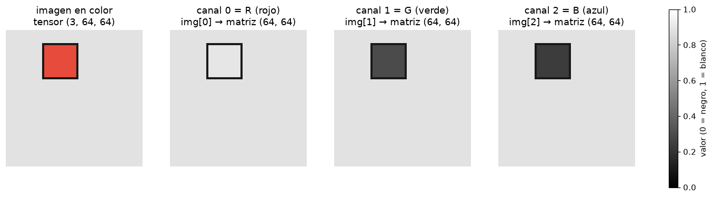

Esto es muy instructivo:

* En el **canal R** (rojo), el cuadrado rojo **casi desaparece**: el relleno vale 230 y el fondo 226, casi lo mismo.
  Solo se ve el contorno negro.
* En los **canales G y B**, el cuadrado es **oscuro** (75 y 60) sobre fondo claro (226): se ve perfectamente.

Conclusión: **ninguna capa sola cuenta toda la historia**; la red tiene que mirar las 3 a la vez. Eso es lo que
hacen los filtros de la primera capa (capítulo 5): cada filtro tiene pesos para R, G **y** B.

### Las formas que vas a encontrar

```
una imagen               (3, 64, 64)       3 canales × 64 filas × 64 columnas
un lote de 64 imágenes   (64, 3, 64, 64)   el primer número = cuántas imágenes
salida de la 1.ª capa    (16, 32, 32)      16 canales (16 filtros), la mitad de alto y ancho
feature maps finales     (32, 8, 8)        32 números por cada casilla de la cuadrícula 8×8
salida de la red         (8, 8, 8)         8 respuestas por casilla
objetivo (respuesta)     (6, 8, 8)         6 números por casilla
```

**Cómo leer un índice:** `img[0]` = el canal 0 entero (una matriz 64 × 64). `target[:, 1, 3]` = «todos los
canales (`:`) de la fila 1, columna 3» → los 6 números de esa casilla.

> **¿Por qué `.permute(2, 0, 1)`?** Las librerías de imágenes guardan `(alto, ancho, color)` = `(64, 64, 3)`.
> PyTorch quiere el color primero: `(3, 64, 64)`. `permute(2, 0, 1)` dice «pon la dimensión 2 primero, luego la 0,
> luego la 1».

> ✅ **Compruébalo**
> * ¿Qué forma tiene un lote de 10 imágenes? *(10, 3, 64, 64)*
> * En el canal G, ¿un cuadrado verde se vería claro u oscuro? *(claro: tiene mucho G)*

---

## 3. La neurona

Una neurona hace **una cuenta muy simple**: multiplica cada entrada por un peso, lo suma todo, suma un sesgo y
pasa el resultado por una activación.

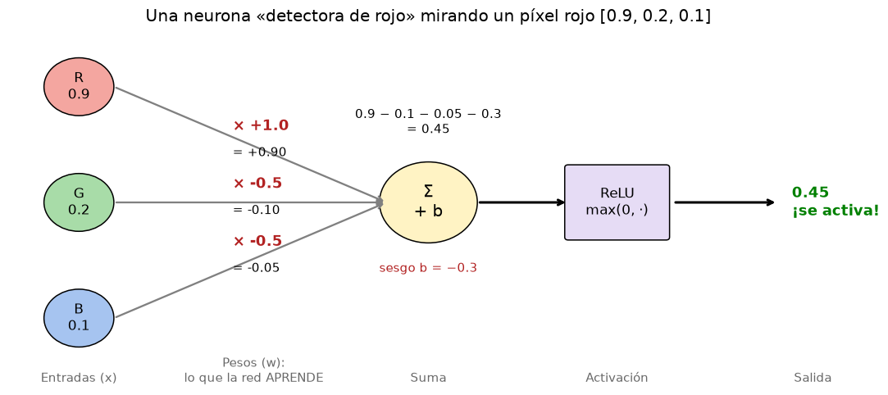

Léelo de izquierda a derecha con el píxel rojo `[0.9, 0.2, 0.1]`:

| paso | cuenta | resultado |
|---|---|---|
| R × peso | 0.9 × (+1.0) | +0.90 |
| G × peso | 0.2 × (−0.5) | −0.10 |
| B × peso | 0.1 × (−0.5) | −0.05 |
| suma + sesgo | 0.90 − 0.10 − 0.05 − 0.3 | **0.45** |
| ReLU | max(0, 0.45) | **0.45 → se activa** |

Con un píxel **gris** `[0.9, 0.9, 0.9]`: 0.9 − 0.45 − 0.45 − 0.3 = −0.3 → ReLU → **0 → no se activa**.

**La idea clave**: lo que la neurona detecta lo deciden **los pesos** (en rojo en el dibujo). Con pesos
`[−0.5, −0.5, +1.0]` detectaría el azul. **Aprender = encontrar buenos pesos.** Al principio son aleatorios.

### De una neurona a una red

Una **capa** = muchas neuronas mirando lo mismo, cada una con sus pesos (cada una detecta algo distinto).
Una **red** = capas apiladas: las salidas de una son las entradas de la siguiente.

```
 píxeles ──► [capa 1: detecta colores y bordes] ──► [capa 2: combina bordes → esquinas] ──► ... ──► respuesta
```

> ✅ **Compruébalo**
> * ¿Qué pesos pondrías para detectar píxeles **oscuros**? *(todos negativos, p. ej. [−1, −1, −1], y un sesgo positivo)*
> * ¿Quién elige los 35 736 pesos de nuestra red? *(el entrenamiento, capítulo 11)*

---

## 4. ReLU, sigmoide y softmax

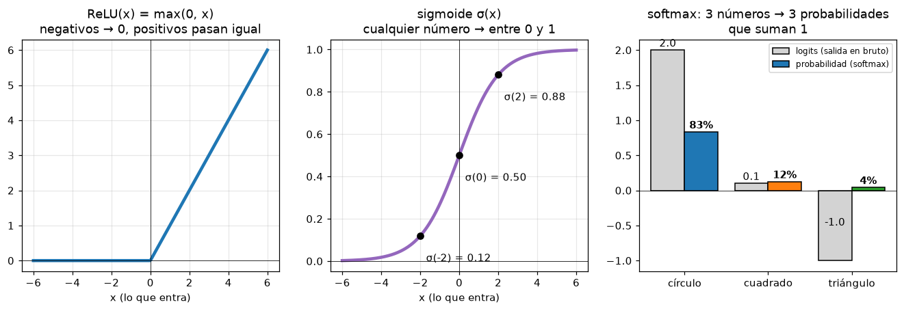

| función | qué hace | dónde la usamos | por qué |
|---|---|---|---|
| **ReLU** (izquierda) | negativos → 0, positivos igual | detrás de **cada** convolución del backbone | sin ella, apilar capas no sirve de nada (ver abajo) |
| **sigmoide** (centro) | cualquier número → entre 0 y 1 | canales 0–4 de la salida: ¿objeto?, dx, dy, w, h | son probabilidades o fracciones, deben estar entre 0 y 1 |
| **softmax** (derecha) | varios números → probabilidades que suman 1 | canales 5–7: círculo, cuadrado, triángulo | hay que **elegir una** de 3 opciones |

**Leer el gráfico de softmax:** las barras grises son lo que sale de la red «en bruto» (los **logits**):
2.0, 0.1, −1.0. Las barras de color son las probabilidades: 83 %, 12 %, 4 %. El orden se mantiene (el mayor sigue
siendo el mayor), pero ahora son porcentajes comparables que suman 100 %.

### ¿Por qué hace falta la ReLU? (explicado con números)

Una capa sin activación hace `y = 2·x`. Otra encima hace `z = 3·y`. Juntas: `z = 6·x`… **que es una sola capa**.
Da igual cuántas apiles: sigue siendo «multiplicar por un número». La ReLU rompe esto: `z = 3·max(0, 2·x)` ya **no**
es una simple multiplicación (para x negativos da 0, para positivos 6x). Ese «doblez» es lo que permite que la red
dibuje fronteras complicadas («esto es un triángulo, esto no»).

> ✅ **Compruébalo**
> * σ(0) = ? *(0.5: «no lo sé»)*
> * Si la red da logits [5, 5, 5], ¿qué da el softmax? *(1/3, 1/3, 1/3: no se decide)*

---

## 5. La convolución

### 5.1 La operación, paso a paso

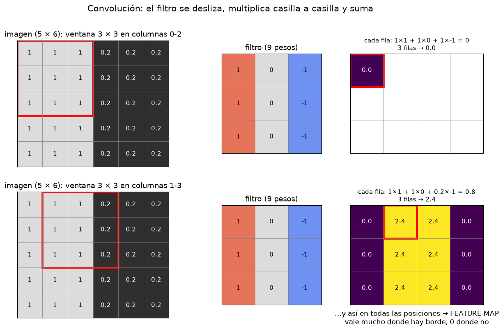

* **Fila de arriba:** el filtro (centro) se coloca sobre las columnas 0–2 de la imagen (recuadro rojo). Se
  multiplican las 9 casillas por los 9 pesos y se suma: `1×1 + 1×0 + 1×(−1) = 0` por fila, ×3 filas = **0**.
  Ese 0 se escribe en la primera casilla de la salida.
* **Fila de abajo:** el filtro avanza una columna (columnas 1–3). Ahora la última columna vale 0.2:
  `1×1 + 1×0 + 0.2×(−1) = 0.8` por fila → **2.4**.
* Haciendo esto en **todas** las posiciones sale el mapa de la derecha: **2.4 justo donde hay un borde, 0 donde no**.

Ese mapa se llama **feature map** («mapa de características»): dice **dónde** aparece aquello que busca el filtro.

### 5.2 Los mismos filtros sobre nuestra imagen real

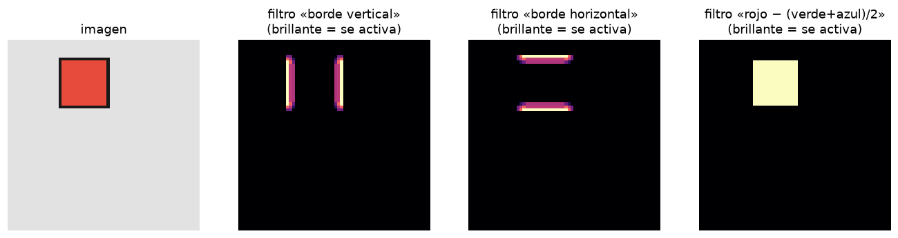

* El filtro **borde vertical** se enciende en los lados izquierdo y derecho del cuadrado.
* El filtro **borde horizontal**, en los lados de arriba y abajo.
* Un «filtro» que calcula *rojo − (verde+azul)/2* se enciende en todo el relleno rojo.

Con 3 filtros ya tenemos: «hay bordes verticales aquí, horizontales allí, y es rojo». Combinando esas pistas,
una capa siguiente podría decir «4 bordes rectos que forman esquinas → cuadrado».

### 5.3 Lo que aprendió **nuestra** red

En nuestra red **nadie escribe los filtros**: sus números son pesos que se aprenden. Estos son los 16 filtros de la
primera capa después del entrenamiento, y lo que producen sobre nuestra imagen:

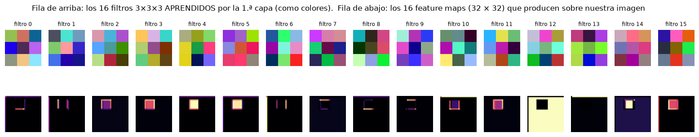

* **Arriba:** cada filtro es de 3 × 3 × 3 (3 × 3 posiciones × 3 colores); se dibuja como un cuadradito de 9 colores.
  Parecen ruido, pero no lo son.
* **Abajo:** su feature map. Mira algunos: el **0** y el **8** detectan esquinas/bordes de un lado concreto,
  el **1** y el **6** los bordes verticales, el **4** y el **5** el relleno de la figura, el **12** **el fondo**
  (se enciende en todo excepto en la figura). **La red ha inventado sola** detectores de bordes, como los que
  habíamos hecho a mano.

### 5.4 Stride (paso) y padding (relleno)

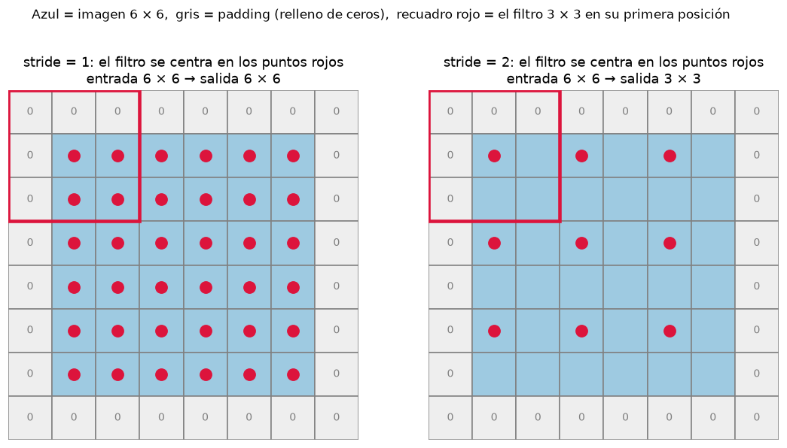

* **Padding = 1** (casillas grises con 0): un marco de ceros alrededor. Sin él, el filtro no podría centrarse
  en los píxeles del borde y la imagen encogería en cada capa.
* **Stride = 1** (izquierda): el filtro se centra en **todos** los píxeles → salida del **mismo** tamaño (6 × 6).
* **Stride = 2** (derecha): el filtro salta de 2 en 2 → salida de **la mitad** (3 × 3).

En nuestra red: cada stride 2 divide el tamaño por 2. Tres veces: 64 → 32 → 16 → 8. De ahí el `STRIDE = 8` total.

### 5.5 El campo receptivo: ¿cuánto «ve» cada casilla?

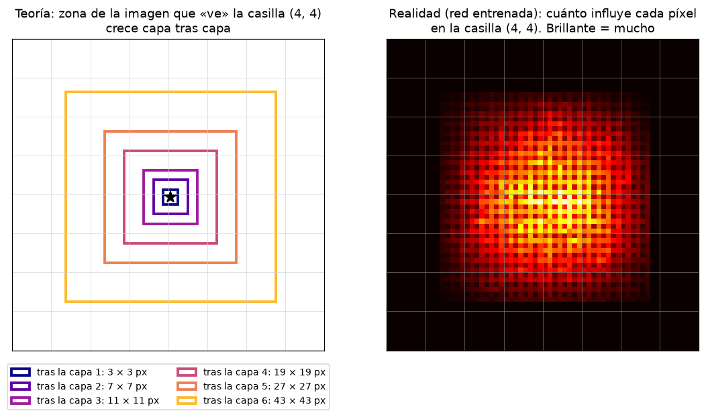

* **Izquierda (teoría):** tras la capa 1, un valor depende de 3 × 3 píxeles. Tras la capa 2, de 7 × 7 (porque mira
  3 × 3 valores que a su vez miraban 3 × 3 píxeles). Así hasta **43 × 43 píxeles** tras la capa 6: más de la mitad
  de la imagen. Las figuras miden como mucho 21 píxeles → **cada casilla puede ver una figura entera**.
* **Derecha (realidad, red entrenada):** hemos medido cuánto cambia la casilla (4, 4) si se toca cada píxel. La zona
  brillante coincide con el cuadrado teórico, y **el centro pesa mucho más que los bordes**.

Esto explica uno de los resultados del notebook: **el modelo pequeño** (3 capas) tiene un campo receptivo de solo
15 × 15 px, más pequeño que muchas figuras, y localiza peor (IoU 0.78 frente a 0.95).

> ✅ **Compruébalo**
> * Si a una imagen 32 × 32 le aplicas una conv con stride 2, ¿qué tamaño sale? *(16 × 16)*
> * `Conv2d(3, 16, kernel_size=3)`: ¿cuántos pesos tiene cada filtro? ¿Cuántos mapas produce? *(3×3×3 = 27; 16 mapas)*
> * ¿Por qué el filtro 12 se enciende «al revés» (todo menos la figura)? *(detecta el color del fondo)*

---

## 6. BatchNorm

**Problema:** los valores que salen de una convolución pueden estar en cualquier rango, y ese rango cambia
mientras la red aprende. A la capa siguiente le cuesta adaptarse a un objetivo que se mueve.

**Solución:** después de cada convolución, **recentrar y reescalar** los valores. Así se ve con datos reales
(canal 3 de la primera capa, 64 imágenes):

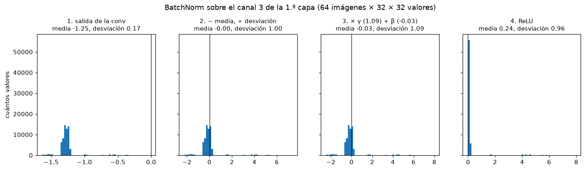

1. **Salida de la conv:** casi todos los valores rondan **−1.25** (el fondo), con algunos sueltos más altos (la figura).
2. **Restar la media y dividir por la desviación:** ahora la media es **0** y la desviación **1**. La forma del
   histograma no cambia, solo se desplaza y se estira.
3. **× γ + β:** la BatchNorm tiene **2 números aprendidos por canal** (γ = 1.09, β = −0.03 aquí) que permiten a la red
   ajustar el rango si le conviene. Son los `backbone.1.weight` y `backbone.1.bias` que ves en la lista de pesos.
4. **ReLU:** los negativos (el fondo) pasan a 0. Solo quedan los valores de la figura → el canal «se enciende» en la figura.

### `model.train()` y `model.eval()`

* En **entrenamiento**, la media y desviación del paso 2 se calculan con el lote actual (64 imágenes).
* En **evaluación** se usa una media «guardada» durante el entrenamiento. Así la respuesta para una imagen no depende
  de qué otras imágenes vayan en el lote.

Por eso el código llama a `model.train()` antes de entrenar y a `model.eval()` antes de evaluar. Olvidarlo es un
error clásico.

> ✅ **Compruébalo**
> * ¿Cuántos números aprende una BatchNorm de 32 canales? *(2 × 32 = 64)*
> * ¿Qué pasaría si evaluaras una sola imagen en modo `train()`? *(la media se calcularía con 1 imagen: resultados raros)*

---

## 7. La red completa y el viaje de una imagen

### 7.1 El plano

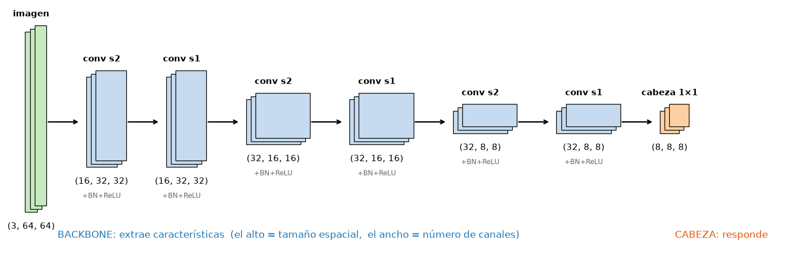

* El **alto** de cada bloque es el tamaño espacial (64 → 32 → 16 → 8) y el **ancho**, el número de canales (3 → 16 → 32).
* Patrón: la imagen se hace **más pequeña** pero **más «gruesa»**: menos posiciones, más información por posición.
* Cada «conv» del backbone es en realidad **Conv 3×3 → BatchNorm → ReLU** (la función `conv_block`).
* Las capas **s2** (stride 2) reducen; las **s1** (stride 1) no reducen, pero añaden una «capa de reflexión» más
  y amplían el campo receptivo.
* La **cabeza** es una conv **1 × 1**: en cada casilla toma los 32 números y calcula 8 combinaciones. Es como
  si en cada casilla hubiera **8 neuronas** mirando sus 32 características.

### 7.2 El viaje: qué sale de cada capa con nuestra imagen

Esta es la figura más importante de la guía. Cada fila es la salida de una capa (mostramos los 8 canales que más
se encienden). Las zonas brillantes son donde ese canal ha encontrado «su» característica.

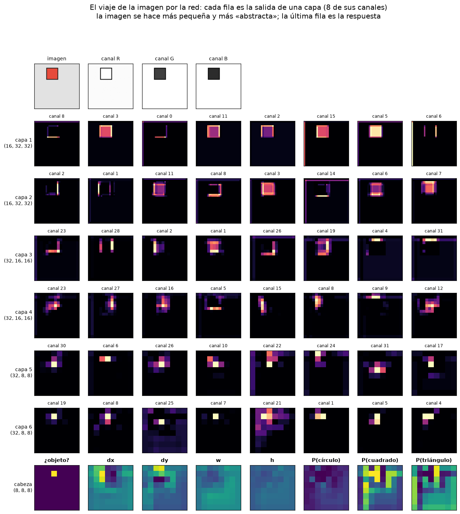

Recorrido de arriba abajo:

| fila | tamaño | qué se ve |
|---|---|---|
| imagen | 64 × 64 | los píxeles y sus 3 canales |
| capa 1 | 32 × 32 | cosas **simples**: bordes de un lado (canal 0, 8), el relleno (5, 11), bordes verticales (6) |
| capa 2 | 32 × 32 | **combinaciones**: esquinas, el contorno entero (canal 1), el interior (3, 7) |
| capas 3–4 | 16 × 16 | partes de la figura cada vez más **abstractas** (un lado, una esquina concreta) |
| capas 5–6 | 8 × 8 | ya no se reconoce la figura: hay **manchas** alrededor de la casilla (1, 3), donde está el centro |
| cabeza | 8 × 8 | las **8 respuestas**: ¿objeto? solo se enciende en (1, 3); P(cuadrado) es alta en muchas casillas |

Dos cosas importantes de la última fila:

* **«¿objeto?»** solo se enciende en **una** casilla: la que contiene el centro. Exactamente lo que le enseñamos.
* **dx, dy, w, h y las P(forma)** tienen valores en **todas** las casillas, pero solo se leen en la casilla del
  objeto. En las demás son «basura» que nadie usa (y por eso la pérdida tampoco los mira, capítulo 9).

### 7.3 ¿De dónde salen los 35 736 pesos?

| capa | cálculo | pesos |
|---|---|---|
| Conv 3→16 | 16 filtros × (3×3×3) + 16 sesgos | 448 |
| BN 16 | 2 × 16 | 32 |
| Conv 16→16 | 16 × (16×3×3) + 16 | 2 320 |
| BN 16 | | 32 |
| Conv 16→32 | 32 × (16×3×3) + 32 | 4 640 |
| BN 32 | | 64 |
| Conv 32→32 (×3) | 3 × (32 × 32×3×3 + 32) | 27 744 |
| BN 32 (×3) | | 192 |
| Cabeza 32→8 | 8 × 32 + 8 | 264 |
| **total** | | **35 736** |

Fíjate: cada filtro tiene tantos «pisos» como canales de entrada. Un filtro de la capa `16→32` es de
16 × 3 × 3 = 144 pesos, porque mira los 16 mapas de la capa anterior a la vez.

> ✅ **Compruébalo**
> * ¿Por qué en las capas 5–6 ya no se ve el cuadrado? *(son 8 × 8: cada casilla resume 8 × 8 píxeles; la información está en los 32 canales, no en el dibujo)*
> * ¿Cuántos pesos tendría la cabeza si hubiera 5 formas en lugar de 3? *((5+5) × 32 + 10 = 330)*

---

## 8. La cuadrícula: cómo se dice «dónde» con números

### 8.1 Codificar: de la etiqueta al objetivo (`code()`)

La red no dibuja cajas: produce números. Hay que decidir **qué números exactos** debería producir para cada imagen.
Ese «objetivo» lo construye `code()`:

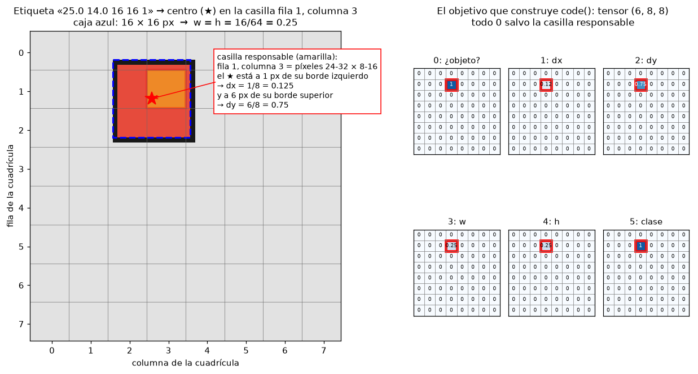

Con la etiqueta `25.0 14.0 16 16 1` (centro en x = 25, y = 14; caja 16 × 16; clase 1 = cuadrado):

| paso | cuenta | resultado |
|---|---|---|
| centro en unidades de casilla | 25 / 8, 14 / 8 | 3.125, 1.75 |
| casilla responsable (parte entera) | | **columna 3, fila 1** (la amarilla) |
| posición dentro de la casilla (parte decimal) | | **dx = 0.125, dy = 0.75** |
| tamaño como fracción de la imagen | 16 / 64 | **w = h = 0.25** |
| clase | | **1** |

A la derecha ves el objetivo completo, forma `(6, 8, 8)`: **6 mapas de 8 × 8, todos a cero salvo la casilla (1, 3)**,
que contiene `[1, 0.125, 0.75, 0.25, 0.25, 1]`.

**¿Por qué dx, dy en lugar de x, y directamente?** Porque cada casilla solo tiene que decir «dónde dentro de **mí**»,
un número entre 0 y 1. Es mucho más fácil que decir «en el píxel 25 de 64». Y la sigmoide garantiza que el centro
predicho no se salga de la casilla.

### 8.2 Decodificar: de la salida de la red a una caja (`decode()` y `predict()`)

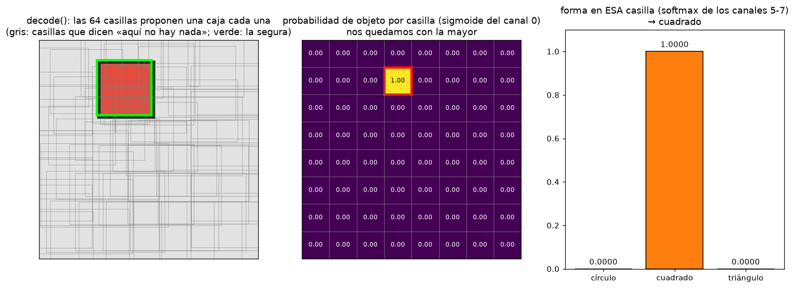

1. **Izquierda:** `decode()` convierte **las 64 casillas** en 64 cajas en píxeles. Cada casilla propone una (cajas
   grises), aunque casi todas «creen» que no hay nada. Solo una está segura (verde).
2. **Centro:** la probabilidad de objeto de cada casilla (sigmoide del canal 0). Una sola casilla dice 1.00:
   la (1, 3). `predict()` se queda con la de mayor puntuación (eso hace `nms(...)[0]`).
3. **Derecha:** en **esa** casilla, el softmax de los canales 5–7 → cuadrado con probabilidad 1.0000.

Las cuentas inversas de `decode()`, con los números perfectos:

```
cx = (columna + dx) × 8 = (3 + 0.125) × 8 = 25   ✔
cy = (fila    + dy) × 8 = (1 + 0.75)  × 8 = 14   ✔
w  = 0.25 × 64 = 16                              ✔
esquinas: x1 = 25 − 8 = 17,  x2 = 25 + 8 = 33,  y1 = 14 − 8 = 6,  y2 = 14 + 8 = 22
```

> **NMS (Non-Maximum Suppression):** cuando varias cajas se solapan mucho, quedarse con la de mayor puntuación y
> tirar las demás. Con una sola figura por imagen solo sirve para «coger la mejor»; con varias figuras sería esencial.

> ✅ **Compruébalo**
> * Un círculo con centro en (60, 3) y lado 10: ¿casilla, dx, dy, w? *(fila 0, columna 7; dx = 0.5, dy = 0.375; w = 0.15625)*
> * ¿Por qué el valor de la clase (canal 5) se guarda como `1.0` y no como «cuadrado»? *(un tensor solo guarda números)*

---

## 9. La pérdida: medir el error

La **pérdida** es **un único número** que dice cuánto se equivoca la red. Todo el entrenamiento consiste en bajarlo.
La nuestra suma **tres errores**, uno por pregunta:

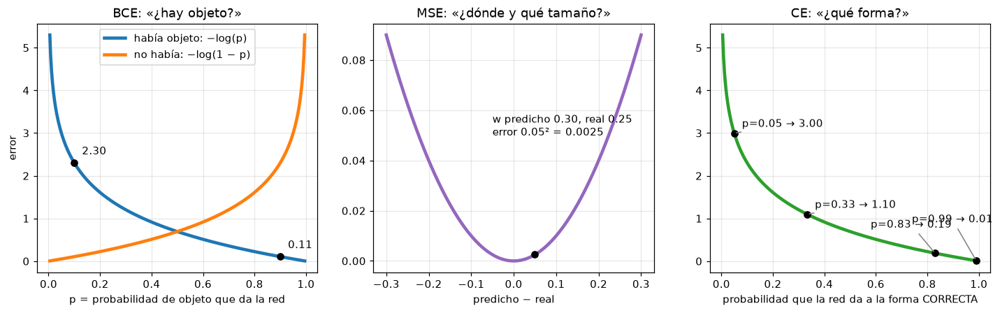

### Izquierda — BCE: «¿hay objeto?» (en las 64 casillas)

* Curva azul (sí había objeto): si la red dice p = 0.9, error 0.11 (poco); si dice 0.1, error **2.30** (mucho).
* Curva naranja (no había): al revés.
* Fíjate en la forma: el error **se dispara** cuando la red está segura **y se equivoca**. Equivocarse con
  seguridad se castiga muchísimo más que dudar.

**Truco `pos_weight=10`:** hay 63 casillas vacías por 1 con objeto. Una red perezosa que siempre dijera «nada»
tendría un error bajo. Multiplicando por 10 el error de la casilla con objeto, esa estrategia deja de compensar.

### Centro — MSE: «¿dónde y de qué tamaño?» (solo casilla responsable)

Error al cuadrado entre `(dx, dy, w, h)` predichos y reales. Si predice w = 0.30 y era 0.25: 0.05² = 0.0025.
Errores tan pequeños pesarían poco al lado de los otros; por eso se multiplica por **10** (`box_weight`).

### Derecha — CE: «¿qué forma?» (solo casilla responsable)

`−log(probabilidad que la red dio a la forma correcta)`:

| la red da a la forma correcta… | error |
|---|---|
| 0.99 | 0.01 |
| 0.83 | 0.19 |
| 1/3 (al azar entre 3) | 1.10 |
| 0.05 | 3.00 |

### ¿Por qué la caja y la forma solo en la casilla responsable?

En una casilla vacía **no hay caja ni forma que adivinar**. Si castigáramos lo que dice ahí, la red perdería
esfuerzo aprendiendo a dar valores concretos para algo que nunca se usa. En el código es la máscara `positive`:

```python
positive = target[:, 0] > 0.5        # True solo en la casilla con objeto
pred_box = ...[positive]             # nos quedamos con esa casilla
```

**Total:** `pérdida = BCE + 10 × MSE + 1 × CE`. Red sin entrenar: ~3.4. Al final: ~0.002.

> ✅ **Compruébalo**
> * Si la red da probabilidad 0.5 a la forma correcta, ¿cuánto vale la CE? *(−log 0.5 ≈ 0.69)*
> * ¿Qué pasaría sin `pos_weight`? *(la red tendería a decir «no hay objeto» en todas partes)*

---

## 10. Entrenamiento y validación

```
 make_dataset(3000, seed=7) ──► ENTRENAMIENTO: la red ajusta sus pesos con estas imágenes
 make_dataset(600,  seed=8) ──► VALIDACIÓN:    nunca se usan para aprender; solo para medir
```

* **¿Por qué separar?** Para saber si la red ha **aprendido** (funciona con imágenes nuevas) o solo ha
  **memorizado** las de entrenamiento (*sobreajuste*). Es como estudiar con unos ejercicios y examinarse con otros.
* **Semilla (`seed`)**: fija el azar. Con `seed=7` siempre salen las mismas 3 000 imágenes → resultados repetibles.
  Semillas distintas para entrenamiento y validación → imágenes distintas.

---

## 11. Cómo aprende: el descenso de gradiente

### 11.1 Con un solo peso

Red mínima: `predicción = w × 2`. Queremos que dé 6, así que el peso ideal es 3. Pérdida = `(2w − 6)²`, una parábola.
Empezamos en w = 1. Cada paso: **mirar la pendiente (el gradiente) y moverse cuesta abajo**, tanto como diga el
learning rate (`lr`).

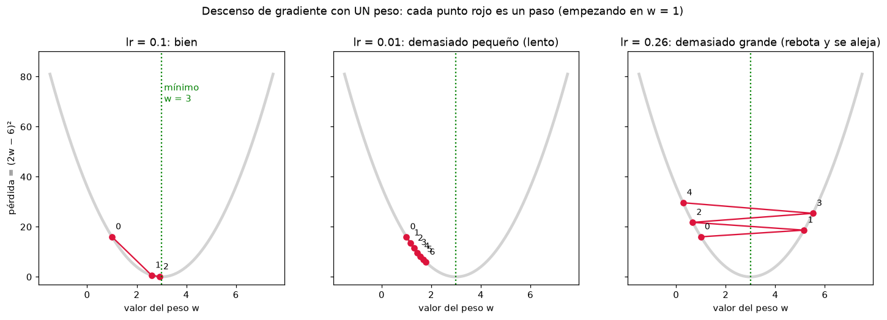

* **lr = 0.1 (izquierda):** 0 → 1 → 2 casi en el mínimo. w: 1 → 2.6 → 2.92. Bien.
* **lr = 0.01 (centro):** pasitos diminutos. Tras 6 pasos aún va por w ≈ 1.8. Llegará, pero tarda una eternidad.
* **lr = 0.26 (derecha):** pasos tan grandes que **salta por encima** del valle, al otro lado, cada vez más arriba.
  **Nunca** llega. Si ves la pérdida subir o volverse `nan` en un entrenamiento, suele ser esto.

Nuestra red hace lo mismo pero en una «montaña» de **35 736 dimensiones** (una por peso). No se puede dibujar,
pero la idea es idéntica: para cada peso, el gradiente dice si subirlo o bajarlo hace bajar la pérdida.

### 11.2 El bucle

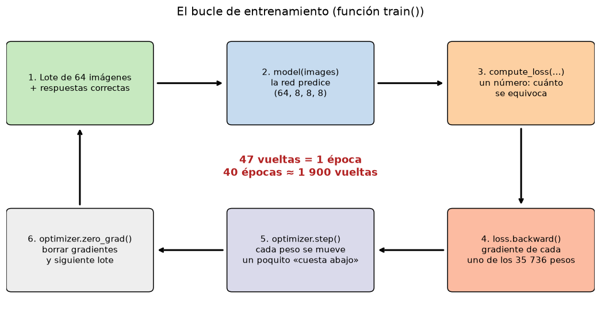

Las 4 líneas de `train()` en [train_multiclass.py](../src/train_multiclass.py):

```python
optimizer.zero_grad()                         # 6. borrar gradientes del lote anterior (si no, se acumularían)
loss = compute_loss(model(images), targets)   # 2 + 3. predecir y medir el error
loss.backward()                               # 4. gradiente de los 35 736 pesos, automáticamente
optimizer.step()                              # 5. mover cada peso un poquito cuesta abajo
```

* **`backward()` (retropropagación):** PyTorch ha ido apuntando todas las cuentas desde la imagen hasta la pérdida.
  Recorriéndolas al revés, calcula cuánto ha contribuido cada peso al error. Es la regla de la cadena de las
  derivadas, aplicada automáticamente.
* **Adam:** un descenso de gradiente mejorado: cada peso tiene su propio tamaño de paso, y tiene «inercia» (si va
  varios pasos en la misma dirección, acelera).
* **`StepLR`:** en la época 30 divide el `lr` entre 10 → pasos más finos para afinar al final (como pasar de
  andar a pasitos cuando ya estás cerca del valle).
* **Lote (64 imágenes)** → una corrección por lote. 3 000 / 64 ≈ **47 correcciones por época**; 40 épocas ≈ **1 900**.

### 11.3 El resultado: antes y después

La **misma** red, sobre las **mismas** imágenes de validación. Arriba con los pesos aleatorios del principio,
abajo con los pesos aprendidos:

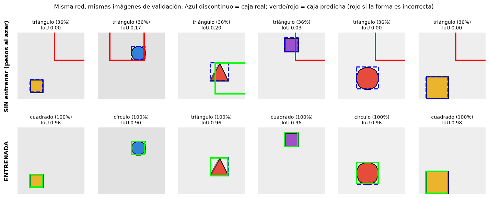

* **Sin entrenar:** dice «triángulo (36 %)» a todo (≈ 1/3: no sabe nada) y propone cajas absurdas (rojas,
  enormes, fuera de sitio). IoU ≈ 0.
* **Entrenada:** forma correcta al 100 % y cajas verdes casi encima de las reales (IoU 0.90–0.98).

Lo único que ha cambiado entre las dos filas son **los 35 736 números**. Eso es aprender.

### 11.4 Las curvas de aprendizaje (del notebook)

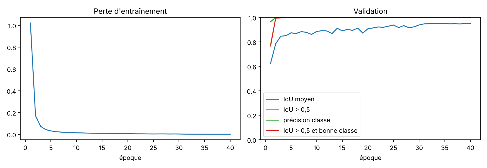

* **Izquierda:** la pérdida cae en picado en las 3 primeras épocas y luego sigue bajando despacio.
* **Derecha:** la forma (verde) llega al 100 % en la época 2: es lo fácil. El IoU medio (azul) sube poco a poco
  hasta ~0.95: **localizar con precisión es lo difícil** y es lo que justifica entrenar 40 épocas.

> ✅ **Compruébalo**
> * ¿Qué pasa si olvidas `optimizer.zero_grad()`? *(los gradientes se suman de un lote a otro y los pasos son erróneos)*
> * Si la pérdida sube en vez de bajar, ¿qué hiperparámetro tocarías primero? *(bajar el learning rate)*

---

## 12. Medir si funciona: IoU y matriz de confusión

### 12.1 IoU: ¿la caja está bien puesta?

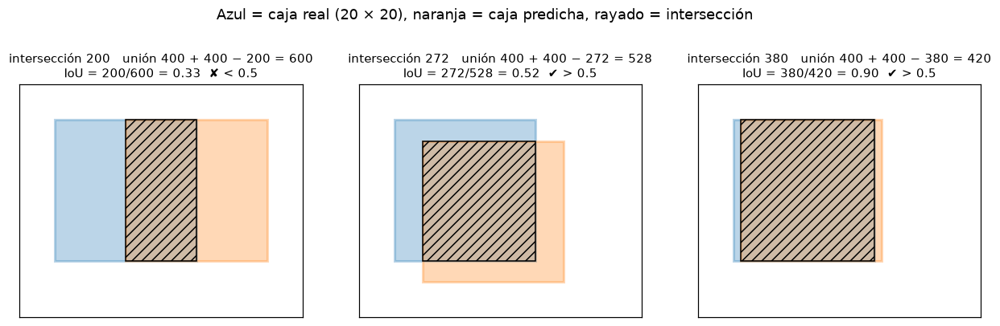

`IoU = área de la intersección (rayada) / área de la unión (todo lo coloreado)`.

* **Izquierda:** desplazada media caja → 0.33 → **mala** (< 0.5).
* **Centro:** desplazada un poco en las dos direcciones → 0.52 → justo **buena**.
* **Derecha:** desplazada 1 píxel → 0.90 → **muy buena**.

Fíjate en el centro: desplazar solo 4 y 3 píxeles ya baja el IoU a 0.52. **El IoU es exigente**. Nuestra red tiene
una media de 0.948 en validación.

### 12.2 Matriz de confusión y distribución de IoU (del notebook)

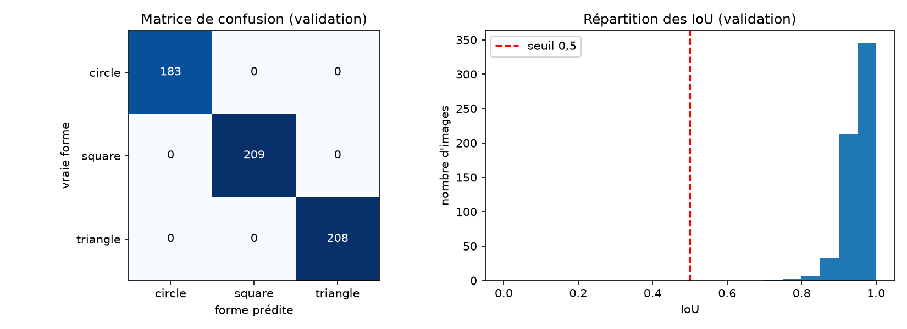

* **Izquierda:** filas = forma real, columnas = forma predicha. Todo está en la diagonal: 183 + 209 + 208 = 600
  aciertos de 600. Si hubiera un error, aparecería fuera de la diagonal (p. ej. un 3 en la fila *circle*, columna
  *square* = «3 círculos tomados por cuadrados»).
* **Derecha:** de las 600 imágenes, **ninguna** está por debajo del umbral 0.5; la gran mayoría entre 0.9 y 1.

**Precisión y recall** (para cuando hay errores): el *recall* de «cuadrado» = de los cuadrados reales, cuántos
reconoció (por fila). La *precisión* = de las veces que dijo «cuadrado», cuántas acertó (por columna).

> ✅ **Compruébalo**
> * Dos cajas idénticas: IoU = ? Dos cajas que no se tocan: IoU = ? *(1 y 0)*

---

## 13. Lo que «piensa» la red: el projector

Para decidir la forma, la cabeza solo mira **32 números**: las características de la casilla responsable.
Son el «carné de identidad» de la figura según la red. No podemos dibujar 32 dimensiones, pero sí aplastarlas a 2
(con un método llamado **PCA**, que busca las 2 direcciones en las que los puntos están más dispersos):

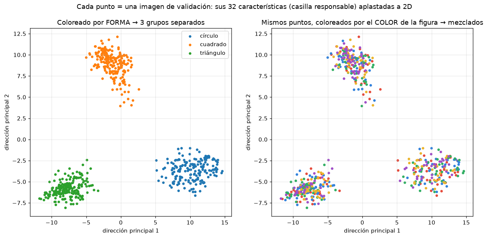

Cada punto es una de las 600 imágenes de validación.

* **Izquierda, coloreado por forma:** **tres nubes completamente separadas**. El backbone ya ha «ordenado» las
  figuras: los cuadrados arriba, los círculos a la derecha, los triángulos a la izquierda. A la cabeza solo le queda
  trazar dos líneas entre las nubes → por eso clasificar es tan fácil y acierta el 100 %.
* **Derecha, mismos puntos coloreados por el color de la figura:** los colores están **mezclados** dentro de cada nube.
  La red ha aprendido a **ignorar el color**, que es justo lo que queríamos (el color se elige al azar y no da pistas
  sobre la forma).

Esto es lo que muestra el **PROJECTOR** de TensorBoard (allí en 3D y con más métodos: PCA, t-SNE, UMAP).

---

## 14. TensorBoard

Durante el entrenamiento, un `SummaryWriter` va escribiendo en unos archivos de *logs*. El programa `tensorboard`
los lee y los muestra en una página web (http://localhost:6006).

```
 notebook ──writer.add_xxx(...)──► archivos de logs (carpeta temporal) ──► tensorboard ──► navegador :6006
```

| en el código | pestaña | equivalente en esta guía |
|---|---|---|
| `add_scalar` | SCALARS | las curvas del apartado 11.4 |
| `add_figure` | IMAGES | ejemplos, matriz de confusión (12.2), predicciones (11.3) |
| `add_graph` | GRAPHS | el plano de la red (7.1) |
| `add_histogram` | HISTOGRAMS | como el capítulo 6, pero de los pesos, época a época |
| `add_embedding` | PROJECTOR | el capítulo 13, en 3D e interactivo |
| `add_hparams` | HPARAMS | la tabla comparativa de los 3 modelos |

Para abrirlo, copia en PowerShell el comando que imprime la celda 3 del notebook y abre http://localhost:6006.

---

## 15. Resumen de todo el recorrido

```
  etiqueta "25 14 16 16 1"                         imagen 64×64×3 (12 288 números entre 0 y 1)
          │ code()                                          │
          ▼                                                 ▼
  objetivo (6, 8, 8)                       BACKBONE: 6 × [Conv 3×3 → BatchNorm → ReLU]
  todo 0 salvo la casilla (1,3)            bordes → esquinas → partes → "hay un cuadrado aquí"
          │                                                 │  (32, 8, 8)
          │                                                 ▼
          │                                CABEZA: Conv 1×1 → (8, 8, 8)
          │                                                 │
          └──────────────► compute_loss ◄───────────────────┘
                     BCE(¿objeto?) + 10·MSE(caja) + CE(forma)
                                   │
                         backward() + step()   ← ajusta los 35 736 pesos
                                   │
                        (× 47 lotes × 40 épocas)

  Al usar la red:  salida (8, 8, 8) ──decode()──► 64 cajas ──predict()──► la mejor caja + su forma
```

### Los resultados, con todo lo que ya sabes

| modelo | campo receptivo | IoU | IoU > 0.5 | forma correcta | pesos |
|---|---|---|---|---|---|
| Detector del TP (solo caja) | 15 px | 0.780 | 96.2 % | – | 6 309 |
| Nuestro modelo, backbone pequeño | 15 px | 0.782 | 96.2 % | 100 % | 6 408 |
| Nuestro modelo, backbone profundo | 43 px | **0.948** | **100 %** | **100 %** | 35 736 |

1. **Añadir la forma no estropea la caja** (0.780 → 0.782) y solo cuesta 99 pesos (3 neuronas nuevas en la
   cabeza: 3 × 32 + 3).
2. **La forma es fácil** (100 % incluso con el modelo pequeño): el projector (cap. 13) muestra tres nubes bien separadas.
3. **La caja es lo difícil**, y mejora con un backbone más profundo: más campo receptivo (cap. 5.5) y más pesos.
4. **Límites:** una sola figura, sin rotación, sin ruido, fondo liso, siempre tan ancha como alta. Con fotos reales
   estos números serían mucho peores.

---

## Glosario visual

| término | en pocas palabras | figura |
|---|---|---|
| píxel | punto con 3 números (R, G, B) | [01](guia_img/01_pixeles.png) |
| canal | una «capa» de un tensor (R, G, B o un feature map) | [02](guia_img/02_canales.png) |
| neurona / peso / sesgo | suma ponderada + sesgo + activación; los pesos se aprenden | [03](guia_img/03_neurona.png) |
| ReLU / sigmoide / softmax | max(0,x) / a [0,1] / probabilidades que suman 1 | [04](guia_img/04_activaciones.png) |
| logit | salida en bruto, antes de sigmoide/softmax | [04](guia_img/04_activaciones.png) |
| convolución / filtro | ventana de pesos que se desliza por la imagen | [05](guia_img/05_convolucion.png) |
| feature map | mapa de dónde aparece una característica | [05c](guia_img/05c_filtros_aprendidos.png) |
| stride / padding | tamaño del salto / marco de ceros | [05d](guia_img/05d_stride_padding.png) |
| campo receptivo | zona de la imagen que influye en un valor | [05e](guia_img/05e_campo_receptivo.png) |
| BatchNorm | recentrar y reescalar cada canal | [06](guia_img/06_batchnorm.png) |
| backbone / cabeza | extrae características / da la respuesta | [07a](guia_img/07a_arquitectura.png) |
| casilla responsable | la que contiene el centro de la figura | [08a](guia_img/08a_cuadricula.png) |
| code / decode | etiqueta → objetivo / salida → cajas en píxeles | [08a](guia_img/08a_cuadricula.png), [08b](guia_img/08b_decodificar.png) |
| BCE / MSE / CE | error de sí/no, de valores, de elegir clase | [09](guia_img/09_perdidas.png) |
| gradiente / learning rate | hacia dónde mover cada peso / cuánto | [11a](guia_img/11a_descenso.png) |
| lote / época | 64 imágenes / una pasada por las 3 000 | [11b](guia_img/11b_bucle.png) |
| IoU | intersección / unión de dos cajas | [12](guia_img/12_iou.png) |
| matriz de confusión | tabla real × predicha | [confusion](../figures/confusion_iou.png) |
| PCA / projector | aplastar 32 dimensiones a 2–3 para verlas | [13](guia_img/13_projector.png) |
