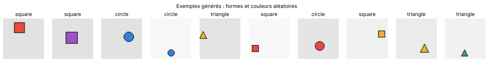
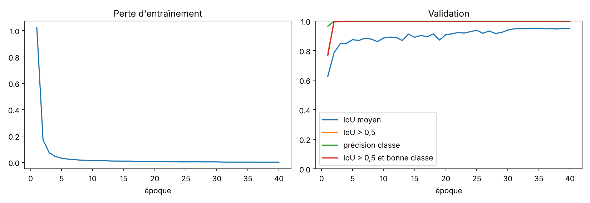
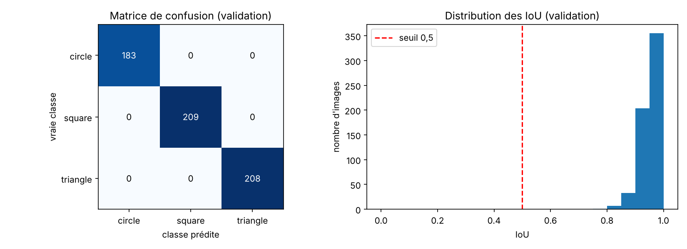
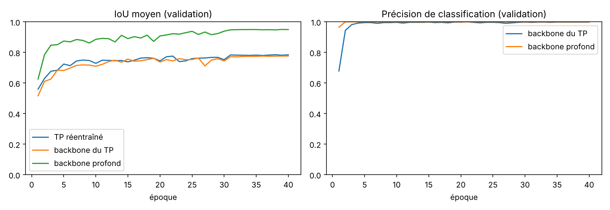
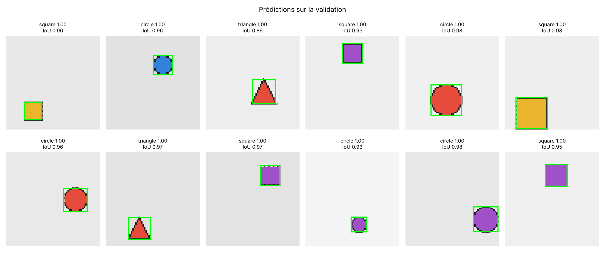
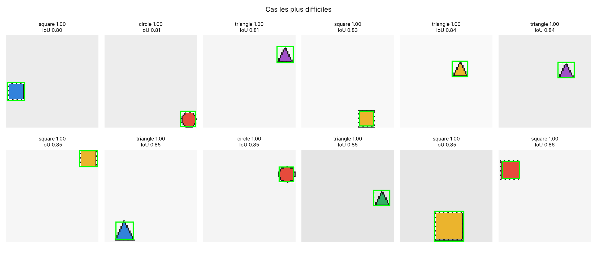

# 1. Objectif

Le TP consistait à entraîner un détecteur qui, sur une image RGB $64\times64$ contenant **une seule figure
toujours identique** (un disque rouge), prédit la présence d'un objet et sa boîte englobante $(c_x, c_y, w, h)$.
L'**Option B** étend ce détecteur : le générateur produit des **cercles, carrés et triangles de couleurs
variées**, et le réseau doit prédire la **classe** de la figure en plus de sa boîte. Le code se compose de :

| fichier | rôle |
|---|---|
| `src/dataset_generator_2.py` | générateur : une figure par image, forme et couleur aléatoires |
| `src/detector_multiclass.py` | codage/décodage, dataset, modèle `MultiClassDetector`, perte, prédiction |
| `src/train_multiclass.py` | entraînement d'une époque, évaluation, courbes, script complet |
| `notebooks/mini_projet_option_B.ipynb` | démarche complète commentée : TP, extension, résultats, figures |

Seules les bibliothèques du TP sont utilisées (`torch`, `numpy`, `PIL`, `matplotlib`).

# 2. Rappel : le détecteur du TP

Image $3\times64\times64$ → *backbone* de 3 blocs « conv $3\times3$ stride 2 + BatchNorm + ReLU »
($3\to8\to16\to32$ canaux, $64\to32\to16\to8$ pixels) → feature maps $32\times8\times8$ → tête conv $1\times1$
→ $5\times8\times8$ : pour chaque cellule $(t_o, t_x, t_y, t_w, t_h)$ → décodage → NMS → une boîte.
Le problème est simplifié par rapport au cours : une seule figure, une seule classe, pas d'ancres,
une seule échelle. Entraîné 30 époques sur 2 000 images (validation : 400 images), il atteint
un **IoU moyen de 0,895** et **100 % d'IoU > 0,5** sur les cercles rouges.

# 3. Choix de conception

**Générateur.** La forme est tirée uniformément parmi `circle` (0), `square` (1), `triangle` (2) et la couleur
parmi 5 couleurs (rouge, bleu, vert, jaune, violet). La couleur étant indépendante de la classe, le réseau
ne peut pas « tricher » : il doit apprendre la **forme**. Le côté varie de 10 à 21 pixels, la position est
aléatoire, le fond est un gris clair aléatoire. L'étiquette devient `"cx cy w h class_id"` (pixels).

**Tête.** La conv $1\times1$ passe de 5 à $5 + C = 8$ canaux par cellule :
objectness $t_o$, boîte $(t_x, t_y, t_w, t_h)$, et $C=3$ logits de classe $(z_1, z_2, z_3)$.
La sortie reste un tenseur $8\times G\times G$ : une seule boîte par cellule, mais avec une classe.

**Backbone.** On conserve les contraintes du TP (sortie $32\times8\times8$, BatchNorm et non-linéarité à chaque
couche) mais chaque étage reçoit une **seconde convolution $3\times3$ de stride 1** :
$3\to16\to16$, $16\to32\to32$, $32\to32\to32$ (6 couches, 35 736 paramètres contre 6 309).
Le champ réceptif et la capacité augmentent sans changer la taille de sortie. Le paramètre `deep=False`
redonne exactement le backbone du TP, ce qui permet la comparaison de la section 6.

**Prédiction.** Le score d'une cellule est $\sigma(t_o)$ ; on applique la NMS (seuil 0,5) puis on garde la
meilleure boîte. Sa classe est $\arg\max_k p(k)$ avec la probabilité $p(k)$ affichée sur les exemples.

# 4. Codage, décodage et perte modifiés

**Codage** (stride $S=8$, grille $G=8$, taille $N=64$). La cellule responsable est celle qui contient le centre :
$j=\lfloor c_x/S\rfloor$, $i=\lfloor c_y/S\rfloor$. La cible passe de $5\times G\times G$ à $6\times G\times G$ :

$$
Y_{:,i,j} = \Big(1,\ \tfrac{c_x}{S}-j,\ \tfrac{c_y}{S}-i,\ \tfrac{w}{N},\ \tfrac{h}{N},\ k\Big),
\qquad Y_{:,i',j'} = 0 \ \text{pour toute autre cellule},
$$

où $k\in\{0,1,2\}$ est le numéro de la classe (6ᵉ canal, lu uniquement sur la cellule positive).

**Décodage** (inchangé pour la boîte, ajout du softmax pour la classe) : pour la cellule $(i, j)$,

$$
\hat c_x=(j+\sigma(t_x))\,S,\quad \hat c_y=(i+\sigma(t_y))\,S,\quad \hat w=\sigma(t_w)\,N,\quad \hat h=\sigma(t_h)\,N,
$$

$$
[x_1,y_1,x_2,y_2]=\big[\hat c_x-\tfrac{\hat w}{2},\ \hat c_y-\tfrac{\hat h}{2},\ \hat c_x+\tfrac{\hat w}{2},\ \hat c_y+\tfrac{\hat h}{2}\big],\qquad
\text{score}=\sigma(t_o),\qquad p(k)=\frac{e^{z_k}}{\sum_{k'} e^{z_{k'}}}.
$$

**Perte.** On ajoute à la perte du TP une entropie croisée sur la classe, calculée **seulement sur la cellule
positive** (ailleurs il n'y a pas d'objet, donc pas de classe à apprendre) :

$$
\mathcal L=\underbrace{\text{BCE}_{w_+=10}(t_o,\,o)}_{\text{64 cellules}}
+\lambda_{box}\,\underbrace{\big\|\sigma(t_{x,y,w,h})-(d_x,d_y,\tfrac{w}{N},\tfrac{h}{N})\big\|^2}_{\text{cellule positive (MSE)}}
+\lambda_{cls}\,\underbrace{\Big(-\log\frac{e^{z_k}}{\sum_{k'}e^{z_{k'}}}\Big)}_{\text{cellule positive (CE)}}
$$

avec $\lambda_{box}=10$, $\lambda_{cls}=1$ et un poids $w_+=10$ sur la cellule positive pour compenser le
déséquilibre 1 positive / 63 négatives. On n'optimise pas l'IoU directement : elle est nulle (gradient nul)
dès que les boîtes ne se chevauchent pas et non dérivable aux bords de l'intersection.

# 5. Protocole expérimental

3 000 images d'entraînement et 600 de validation, générées avec des graines différentes.
Adam, pas $3\cdot10^{-3}$ divisé par 10 à l'époque 30, batches de 64, 40 époques, graine fixe (reproductible).
Métriques sur la validation : **IoU moyen**, **proportion d'IoU > 0,5**, **précision de classification**,
**matrice de confusion** et proportion de **détections complètes** (IoU > 0,5 *et* bonne classe).

# 6. Résultats

{width=100%}

**Courbes d'apprentissage.** La perte décroît rapidement ; la classification est apprise en quelques époques,
la localisation s'améliore plus lentement et gagne encore après la baisse du pas d'apprentissage (époque 30).

{width=88%}

**Résultats chiffrés (validation, 600 images).**

| modèle | IoU moyen | IoU > 0,5 | classe correcte | paramètres |
|---|---:|---:|---:|---:|
| TP entraîné sur cercles rouges, sans réentraînement | 0,366 | 26,2 % | — | 6 309 |
| TP réentraîné sur les données multi-classes (boîte seule) | 0,784 | 96,3 % | — | 6 309 |
| Multi-classes, backbone du TP (`deep=False`) | 0,777 | 95,5 % | 99,8 % | 6 408 |
| **Multi-classes, backbone profond** | **0,949** | **100 %** | **100 %** | 35 736 |

Pour le modèle final, la détection complète (IoU > 0,5 et bonne classe) est de **100 %** ; l'IoU moyen par classe
vaut 0,953 (cercle), 0,951 (carré) et 0,944 (triangle), et la matrice de confusion est diagonale
(183 cercles, 209 carrés, 208 triangles, aucune confusion). Selon la taille de la figure, l'IoU moyen passe de
**0,933** (côté 10–13 px) à 0,954 (14–17 px) et **0,960** (18–21 px).

{width=88%}

{width=88%}

**Exemples visuels.** Boîte prédite verte (classe correcte) ou rouge (classe fausse), vraie boîte en pointillés ;
titre : classe prédite, probabilité, IoU. Les cas « les plus difficiles » (plus faibles IoU) restent bien localisés
(IoU ≥ 0,80) : l'erreur résiduelle est un décalage d'un ou deux pixels, surtout sur les **petites figures**
et sur les figures **collées au bord de l'image**.

{width=100%}

{width=100%}

**Analyse.**

* **Le détecteur du TP ne généralise pas** : entraîné sur des cercles rouges, il n'obtient que 0,366 d'IoU sur les
  nouvelles formes et couleurs. Il faut réentraîner sur des données représentatives.
* **Ajouter la classe ne dégrade pas la localisation** : avec le même backbone, le modèle multi-classes
  (0,777) localise aussi bien que le détecteur du TP réentraîné (0,784), tout en classant 99,8 % des figures.
* **La classification est facile ici** : même le petit backbone du TP sépare presque parfaitement les trois formes.
  Le fond uniforme et les contours noirs rendent la forme très visible.
* **La profondeur du backbone améliore surtout la localisation** : l'IoU moyen passe de 0,777 à 0,949.
  Ce gain s'accompagne de 5,6 fois plus de paramètres ; une partie vient donc simplement de la capacité.

# 7. Limites et perspectives

* **Données très simplifiées** : une figure par image, toujours de largeur égale à la hauteur ($w=h$), sans rotation
  ni bruit, sur fond uniforme. Les scores proches de 100 % ne seraient pas atteints sur des images réelles,
  et la précision de classification ne permet pas de départager les modèles.
* **La NMS ne sert presque pas** : avec un seul objet, on garde la boîte de meilleur score. Avec plusieurs
  objets (Option C), il faudrait une NMS par classe et un seuil sur le score.
* **Une seule boîte par cellule** : deux figures dont les centres tombent dans la même cellule ne pourraient pas être
  détectées ; les ancres (Option A) répondraient à ce problème.
* **Score de détection** : on utilise $\sigma(t_o)$ seul ; un score $\sigma(t_o)\times\max_k p(k)$ tiendrait compte
  de l'incertitude de classe, utile pour calculer une mAP.
* **Pistes** : rendre les données plus difficiles (bruit, rotations, rapports $w/h$ variés, formes proches comme
  losange/carré), augmentation de données, réglage de $\lambda_{cls}$, et calcul d'une mAP par classe.
